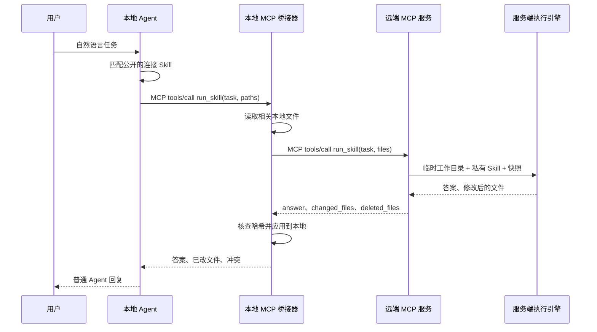

# nunchaku

把私有 Agent Skill 放在服务端执行，并以标准 MCP 工具提供给客户本地的 Codex、Claude Code 等 Agent。当前版本是一个可运行的 POC。详细设计见[架构说明](docs/architecture.md)。

## 架构



- **本地公开连接 Skill**：只有用途说明和操作步骤，帮助 Agent 在用户自然语言请求下自动选择 MCP 工具。客户可以看到这部分内容。
- **本地 MCP 桥接器**：通过 stdio MCP 接入 Codex/Claude Code。Agent 只传路径；桥接器读取文件、调用远端、核查哈希并应用结果。也可跳过桥接器，直连远端 MCP。
- **远端 MCP 协议**：使用标准 Streamable HTTP。客户端负责 `initialize`、`tools/list`、`tools/call`；本项目不定义另一套传输协议。
- **应用层协议**：远端 `run_skill(task, files)` 接收 `{path, content}` 列表，返回 `answer`、`changed_files` 和 `deleted_files`。改动带原文件 `base_sha256` 以检测冲突。路径以客户项目根目录为基准；文件内容为 UTF-8 文本。
- **服务端执行**：每次调用创建临时目录，复制私有 Skill 和明确提交的文件，运行配置的 `codex`、`claude`、`hermes` 或自定义 CLI，收集文件变化，随后删除临时目录。
- **服务配置**：每个服务一个 Skill、执行引擎和端口；可运行单个服务或全部服务。每个端口都有独立的 `/mcp` 端点。

## 快速开始

需要 Python 3.11+、`uv` 和服务器上已安装并可用的执行引擎 CLI。引擎自身的模型账号或 API 凭据由服务器持有，客户端不需要这些凭据。

```bash
uv sync
cp services.example.json services.json
uv run nunchaku --config services.json list
uv run nunchaku --config services.json serve demo-polish
```

### 可视化管理台

也可以不先创建配置文件，直接启动本机管理台：

```bash
uv run nunchaku --config services.json dashboard --port 8787
```

打开 <http://127.0.0.1:8787/>。页面支持新建、编辑、删除服务；选择私有 Skill 目录、执行引擎、监听地址和端口；启动/停止单个 MCP 服务；查看状态与最近日志；复制 MCP 地址；按客户可访问的 URL 下载公开连接包。配置变更会原子写入 `services.json`，日志保存在配置文件旁的 `.nunchaku/logs/`。运行中的服务需要先停止才能修改或删除；退出管理台会停止由它启动的服务。

管理台只监听 `127.0.0.1`，目前没有登录和鉴权。若管理台部署在远端服务器，可通过 SSH 隧道访问：`ssh -L 8787:127.0.0.1:8787 user@provider-host`。管理台显示的 `127.0.0.1` MCP 地址仅对服务端本机有效；导出连接包时应填写**客户机器实际能访问到的地址**，例如客户侧 SSH 隧道的本机地址或后续 HTTPS 反向代理地址。

示例只监听 `127.0.0.1:8765`。另一个终端把本地连接 Skill 生成到任意临时目录：

```bash
uv run nunchaku --config services.json client-skill demo-polish \
  --url http://127.0.0.1:8765/mcp \
  --output /tmp/demo-polish-remote
uv build
```

跨机器验证时，可先建立 SSH 端口转发（在客户机器执行 `ssh -L 8765:127.0.0.1:8765 user@provider-host`），再让连接配置使用 `http://127.0.0.1:8765/mcp`。这里的 `user@provider-host` 是占位值；当前 POC 没有鉴权，不要直接开放公网端口。

给客户分发通用 `nunchaku` wheel 和上一步生成的公开连接 Skill；wheel 不包含真实私有 Skill。客户机器安装 wheel 后配置本地桥接器。以下以 Codex 为例（wheel 文件名以实际构建结果为准；命令在客户机器执行）：

```bash
uv tool install dist/nunchaku-0.1.0-py3-none-any.whl
mkdir -p ~/.agents/skills
cp -R /tmp/demo-polish-remote ~/.agents/skills/
codex mcp add nunchaku-demo-polish -- nunchaku bridge \
  --connector "$HOME/.agents/skills/demo-polish-remote/connector.json" \
  --root /absolute/path/to/customer/project
codex mcp list
```

Codex 对 MCP 工具有自己的审批和超时设置。桥接器默认会写入客户项目；客户确认信任该服务后，可在 `~/.codex/config.toml` 的相应服务配置中加入以下值，以减少每次调用的审批打断，并让 180 秒的远端任务有足够时间返回：

```toml
[mcp_servers.nunchaku-demo-polish]
tool_timeout_sec = 210

[mcp_servers.nunchaku-demo-polish.tools.run_skill]
approval_mode = "approve"
```

如果希望每次调用都先由客户审核，保留默认审批设置即可。某些禁用审批请求的 Codex 环境会直接阻止未经批准的写入型 MCP 工具；此时需要上述按工具信任配置。[Codex 配置参考](https://learn.chatgpt.com/docs/config-file/config-reference)列出了这两个字段。

Claude Code 也可以连接同一地址：

```bash
mkdir -p ~/.claude/skills
cp -R /tmp/demo-polish-remote ~/.claude/skills/
claude mcp add --scope user nunchaku-demo-polish -- nunchaku bridge \
  --connector "$HOME/.claude/skills/demo-polish-remote/connector.json" \
  --root /absolute/path/to/customer/project
```

Hermes 可用 `hermes mcp add nunchaku-demo-polish --url http://127.0.0.1:8765/mcp` 直连远端；也可以把 `nunchaku bridge ...` 作为 stdio MCP 命令配置给 Hermes。生成的 `agents/openai.yaml` 提供 Codex 的连接 Skill 展示信息。

用户随后可在本地 Agent 中说“请用 demo-polish 润色 README 的简介”。本地 Agent 调用 `run_skill(task, paths)`；桥接器读取 `README.md`，调用远端服务，核对哈希并应用结果。对于只有问答的 Skill，`paths` 可为空。`apply_changes: false` 可只返回提议，不写客户文件。

如果不安装本地桥接器，可用 `client-skill --mode direct` 生成直连版公开 Skill，再用 `codex mcp add nunchaku-demo-polish --url https://your-host/mcp` 配置。直连版要求 Agent 自行传入文件内容并处理返回文件。

## 服务配置

`services.json` 的 `services` 数组可以添加多个服务：

```json
{
  "services": [
    {
      "name": "my-skill",
      "description": "为技术文档提供语言润色和结构建议。",
      "skill": "/srv/private-skills/my-skill",
      "engine": "codex",
      "host": "127.0.0.1",
      "port": 8765,
      "timeout_seconds": 180
    }
  ]
}
```

`skill` 也可相对配置文件所在目录。每个目录必须有 `SKILL.md`。`command` 可选，用于指定 CLI 可执行文件路径；默认使用与 `engine` 同名的命令。`serve-all` 会为每个服务启动一个子进程。`client-skill` 生成的 Skill 和实际的私有 Skill 是两份内容，部署时只给客户前者。

### 自定义引擎

如果不用 Codex、Claude 或 Hermes，而是用自己的 Agent CLI，把 `engine` 设为 `custom`，并提供 `command` 和 `args`：

```json
{
  "name": "my-skill",
  "description": "为技术文档提供语言润色和结构建议。",
  "skill": "/srv/private-skills/my-skill",
  "engine": "custom",
  "command": "/usr/local/bin/my-agent",
  "args": ["run", "--cwd", "{workspace}", "--output", "{output}", "--prompt", "{prompt}"],
  "port": 8765
}
```

`args` 的每一项就是一个独立的命令行参数，不经过 shell。可用的占位符有：

| 占位符 | 含义 |
| --- | --- |
| `{prompt}` | 完整任务提示词，包含私有 Skill 的位置和用户任务 |
| `{workspace}` | 本次调用的临时工作目录，同时也是进程的 cwd |
| `{output}` | 最终答复文件的路径；引擎没写这个文件时，以 stdout 作为答复 |
| `{skill}` | 私有 Skill 在工作目录里的副本（`.agents/skills/<name>`） |

`args` 里没有 `{prompt}` 时，提示词通过 stdin 传入。引擎必须能非交互地运行完就退出，并直接在 `{workspace}` 里修改文件；退出码非 0 视为失败。管理台「新建服务」里选「自定义引擎」也能填写这些项，命令参数一行一个。

## `run_skill` 数据契约

请求示例：

```json
{
  "task": "把 README 的开头写得更清楚",
  "files": [{"path": "README.md", "content": "# 项目\n原始介绍...\n"}]
}
```

结果示例：

```json
{
  "service": "my-skill",
  "engine": "codex",
  "answer": "已重写开头两段。",
  "changed_files": [{"path": "README.md", "content": "# 项目\n新介绍...\n", "base_sha256": "<原文件的 SHA-256>"}],
  "deleted_files": [],
  "note": "Changes are proposals. The local Agent must review and apply them in the user's workspace."
}
```

这个 POC 限制为最多 50 个输入/输出文本文件，单文件 256 KB、总计 1 MB；单次调用超时默认 180 秒。每次调用无状态，本地 Agent 若要继续上一轮，需把必要上下文再次传入。二进制文件、增量流式进度、大型项目同步和远端实时调用本地工具尚未实现。

## 部署边界与下一步

当前 **没有鉴权**，只适合本机或可信网络内的功能验证。不要把端口直接暴露到公网。客户提交的文件会传到服务端；取得访问权限的人也可能反复向模型提问，试图诱导它复述私有 Skill。私有提示词不能单靠“不要泄露”的指令实现严格保密；真正必须保密的算法、数据和规则应放在服务端代码或受控工具里，不交给可被客户自由提示的模型上下文。

正式交付前优先补上：HTTPS、客户鉴权及服务级授权、调用配额、每次执行的容器隔离、日志脱敏、密钥隔离。若 Skill 必须像本地一样逐步读写整个项目，可在下一阶段增加**本地代理 + 受控文件工具反向调用**，由本地代理对每个读写动作进行路径校验和用户确认；当前 POC 采用显式快照与结果回传，以便先验证客户体验和执行效果。

## 开发验证

```bash
uv run python -m unittest discover -s tests -v
uv run python tests/manual_codex_e2e.py  # 可选：使用真实 Codex 验证自然语言触发，消耗模型额度
```

有关 Codex 的 MCP 配置和 Skill 分工，参见[官方 OpenAI 文档：Docs MCP](https://developers.openai.com/learn/docs-mcp)与[Skills 和 MCP 的关系](https://developers.openai.com/plugins/concepts/skills)。MCP 服务端实现参见[官方 MCP Python SDK 文档](https://py.sdk.modelcontextprotocol.io/run/)。
