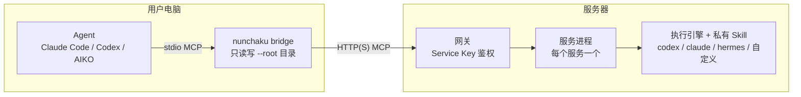

# nunchaku

[](LICENSE)
[](pyproject.toml)
[](https://modelcontextprotocol.io/)

**把私有 Agent Skill 留在服务器上运行，以标准 MCP 工具的形式交给用户本地的 Claude Code、Codex 等 Agent 使用。**

用户照常用自然语言提需求，Skill 的内容和模型凭据始终不离开服务器。

> 项目目前处于 POC 阶段，接口可能变化。

## 为什么需要它

你写了一个好用的 Skill，想给别人用，但又不想把里面的方法论、脚本和 API Key 一起交出去。nunchaku 的做法是：

- **Skill 放在服务器**：用户拿到的只是一个通用连接说明，不包含任何私有内容。
- **用户无感使用**：在自己的 Agent 里说一句"用 demo-polish 润色 README"，结果直接写回本地文件。
- **一个入口管所有服务**：服务器新增服务后，用户刷新一下 MCP 连接就能看到，不用重装。
- **按人授权**：每个用户一个 Service Key，只能调用被授权的服务。

## 工作原理



1. Agent 调用本地桥接器，只传任务描述和文件路径。
2. 桥接器读取文件，发给服务器上的网关，网关转发给对应服务。
3. 服务在临时目录里用私有 Skill 运行执行引擎，把改动后的文件返回。
4. 桥接器校验文件哈希，没有冲突就写回本地。

协议细节见[架构说明](docs/architecture.md)。

## 快速开始

需要 Python 3.11+、[uv](https://docs.astral.sh/uv/)，以及服务器上可用的执行引擎 CLI（如 `codex`）。

### 服务端

```bash
git clone https://github.com/zqllucas123/nunchaku.git
cd nunchaku
uv sync
cp services.example.json services.json

# 创建管理员并打开管理台，在「Service Key」页为用户生成 Key
uv run nunchaku --config services.json admin add admin
uv run nunchaku --config services.json dashboard        # http://127.0.0.1:8787/

# 启动所有服务和网关（也可以在管理台里启停）
uv run nunchaku --config services.json serve-all
uv run nunchaku --config services.json gateway          # http://127.0.0.1:8750/mcp
```

示例配置自带一个 `demo-polish` 服务，用来润色中文文档。

### 客户端

```bash
# 安装 CLI（wheel 由服务端 `uv build` 生成在 dist/ 下）
uv tool install nunchaku-0.1.1-py3-none-any.whl

# 安装通用连接 Skill，一台机器装一次即可
nunchaku install-skill

# 注册 MCP，以 Claude Code 为例
claude mcp add --scope user -e NUNCHAKU_SERVICE_KEY=nk_xxxxxxxx nunchaku -- \
  nunchaku bridge --url http://127.0.0.1:8750/mcp --root /absolute/path/to/project
```

然后在 Agent 里直接说：

> 用 demo-polish 润色 README.md 的简介

Codex、AIKO 的配置方法和常见问题见[客户端接入指南](docs/client_use.md)。

## 配置

所有服务都写在 `services.json` 里：

```json
{
  "gateway": {"host": "127.0.0.1", "port": 8750},
  "services": [
    {
      "name": "my-skill",
      "description": "为技术文档提供语言润色和结构建议。",
      "skill": "/srv/private-skills/my-skill",
      "engine": "codex",
      "host": "127.0.0.1",
      "port": 8765,
      "timeout_seconds": 180
    }
  ]
}
```

| 字段 | 说明 |
| --- | --- |
| `name` | 服务名，也是用户看到的 MCP 工具名 |
| `description` | 工具描述，Agent 靠它判断何时调用 |
| `skill` | 私有 Skill 目录，必须包含 `SKILL.md`；可写相对配置文件的路径 |
| `engine` | `codex`、`claude`、`hermes` 或 `custom` |
| `command` | 可选，引擎可执行文件路径，默认与 `engine` 同名 |
| `port` | 服务端口，只监听本机，不能与网关端口相同 |
| `timeout_seconds` | 单次调用超时，默认 180 秒 |

网关每次列出工具时会重新读取配置，增删服务不需要重启网关。仅在本机开发时，可在 `gateway` 段设 `"auth": false` 关闭鉴权。

### 自定义引擎

想用自己的 Agent CLI，把 `engine` 设为 `custom`，并提供 `command` 和 `args`：

```json
{
  "engine": "custom",
  "command": "/usr/local/bin/my-agent",
  "args": ["run", "--cwd", "{workspace}", "--output", "{output}", "--prompt", "{prompt}"]
}
```

| 占位符 | 含义 |
| --- | --- |
| `{prompt}` | 完整提示词。`args` 里不写它时，提示词从 stdin 传入 |
| `{workspace}` | 本次调用的临时工作目录，也是进程的 cwd |
| `{output}` | 最终答复文件；引擎没写这个文件时，以 stdout 作为答复 |
| `{skill}` | 私有 Skill 在工作目录里的副本 |

引擎需要非交互地运行、直接修改 `{workspace}` 里的文件，然后退出；退出码非 0 视为失败。

## 文档

| 文档 | 适合谁 |
| --- | --- |
| [架构说明](docs/architecture.md) | 想了解设计和协议的开发者 |
| [私有化部署教程](docs/deployment-guide.md) | 在公司服务器上部署的管理员（systemd、Nginx、HTTPS） |
| [客户端接入指南](docs/client_use.md) | 第一次接入的用户，按步骤操作 |
| [客户端配置手册](docs/client-setup.md) | 需要查阅各客户端配置细节和报错的用户 |

## 安全说明

- 网关和管理台对外提供时都应走 HTTPS；各服务进程只应监听本机，由网关访问。
- 管理员账号、会话和 Service Key 保存在 `.nunchaku/auth.db`，只存哈希。
- 用户提交的文件会上传到服务器。
- **提示词无法做到绝对保密**：持有 Key 的人可能反复提问，诱导模型复述私有 Skill。真正需要保密的算法、数据和规则，应放在服务端代码或受控工具里，而不是写进提示词。

## 限制

- 单次调用最多 50 个文件，单文件 10 MB，总计 20 MB。
- 每次调用无状态，要接着上一轮继续，需要重新提供上下文。
- 暂不支持流式进度、大型项目同步，以及远端在执行中回调本地工具。

后续计划：调用配额、容器隔离、日志脱敏、网关到服务的内部鉴权，以及支持 Skill 在执行中按需读写本地文件的双向协议。

## 开发

```bash
uv sync
uv run python -m unittest discover -s tests -v

# 可选：用真实 Codex 跑端到端测试，会消耗模型额度
uv run python tests/manual_codex_e2e.py
```

## 许可证

[Apache License 2.0](LICENSE)
