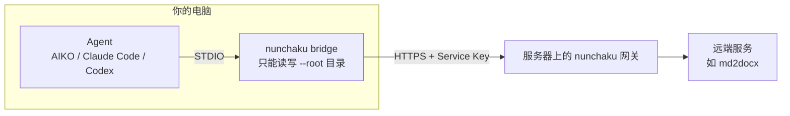

# 客户端接入指南

本文面向**要使用 nunchaku 远端服务的用户**，说明如何在自己的电脑上安装、配置并使用部署在服务器上的 nunchaku 服务。服务器端的部署见[私有化部署与使用教程](deployment-guide.md)，更多客户端细节见[客户端配置与使用手册](client-setup.md)。

---

## 0. 工作方式



- 你在 Agent 里用自然语言提需求，例如「把 设计方案.md 转成 docx」。
- Agent 调用本地的 `nunchaku bridge`。桥接器读取你指定的文件，发到服务器处理，再把结果写回本地目录。
- 真正的处理逻辑（私有 Skill、模型凭据）都在服务器上，**你的电脑不需要任何模型账号或 API Key**。
- 服务器以后新增服务时，你只需**重启一下 MCP 连接**，不用重装任何东西。

---

## 1. 准备工作

### 1.1 向管理员索取

| 项目                 | 示例                                                            | 用途                                 |
| -------------------- | --------------------------------------------------------------- | ------------------------------------ |
| 安装包（wheel）      | `nunchaku-0.1.0-py3-none-any.whl`，或离线用的 `wheels` 目录 | 安装本地 CLI                         |
| 网关地址             | `https://nunchaku.corp.example.com/mcp`                       | 桥接器连接的地址                     |
| Service Key          | `nk_xxxxxxxxxxxxxxxx`                                         | 你的个人访问凭据，决定你能用哪些服务 |
| HTTPS 证书（自签名时必需） | `server-10.0.0.20.crt`                              | 网关用自签名或内部 CA 证书时，桥接器靠它验证服务器身份，见 2.3 |

> Service Key 等同于你的个人账号密码：**不要转借，不要提交到代码仓库，不要发到群里**。怀疑泄露时，请管理员停用并重新生成。

### 1.2 电脑环境

| 项           | 要求                                                                               |
| ------------ | ---------------------------------------------------------------------------------- |
| 操作系统     | Windows 10/11、macOS 或 Linux                                                      |
| `uv`       | 用来安装 CLI，见下文                                                               |
| Python       | 3.11 及以上。联网时 `uv` 会自动下载，不需要手动安装；完全离线时需要预先安装 3.12 |
| Agent 客户端 | AIKO、Claude Code、Codex 或其他支持 MCP 的客户端，任选其一                         |
| 网络         | 能访问网关地址。可以用第 4 章的命令验证                                            |

安装 `uv`（如果 IT 已统一分发，可跳过）：

```powershell
# Windows（PowerShell）
powershell -ExecutionPolicy ByPass -c "irm https://astral.sh/uv/install.ps1 | iex"
```

```bash
# macOS / Linux
curl -LsSf https://astral.sh/uv/install.sh | sh
```

装完后**重新打开终端**，执行 `uv --version` 确认可用。

---

## 2. 安装

### 2.1 安装 nunchaku CLI

```powershell
# 能访问 PyPI 或内网镜像时（wheel 路径以管理员提供的为准）
uv tool install \\fileserver\tools\nunchaku\nunchaku-0.1.0-py3-none-any.whl

# 完全离线时（管理员提供整个 wheels 目录）
uv tool install --offline --no-index --find-links \\fileserver\tools\nunchaku\wheels --python 3.12 nunchaku

# 验证
nunchaku --help
```

公司有内网 PyPI 镜像时，先设置 `$env:UV_INDEX_URL = "https://mirrors.example.com/pypi/simple/"` 再安装。

安装后可执行文件位于：

| 系统          | 路径（下文称 **nunchaku 路径**）        |
| ------------- | --------------------------------------------- |
| Windows       | `C:\Users\<用户名>\.local\bin\nunchaku.exe` |
| macOS / Linux | `~/.local/bin/nunchaku`                     |

如果提示找不到 `nunchaku` 命令，执行 `uv tool update-shell` 后重新打开终端，或直接用上面的完整路径。

### 2.2 安装通用连接 Skill

```powershell
nunchaku install-skill --url https://nunchaku.corp.example.com/mcp
```

命令会列出本机找到的 Agent Skill 目录，输入编号（可用逗号多选，直接回车表示全部）：

```
Agent Skill directories found:
  1. Claude Code  C:\Users\zhangsan\.claude\skills
  2. AIKO         C:\Users\zhangsan\.sdw\skills
  3. Codex        C:\Users\zhangsan\.agents\skills
  4. other directory
Install into [1-4, comma-separated, Enter = all found]:
```

也可以不走交互，直接指定目录（`--path` 可重复）：

```powershell
nunchaku install-skill --path "$HOME\.sdw\skills"
```

- 装好后目录名为 `nunchaku-remote`。它只告诉 Agent「远端能力以 nunchaku MCP 工具的形式提供」，**不含任何服务信息**，一台电脑装一次即可。
- 目录已存在时会拒绝覆盖；确实要覆盖时加 `--force`。

### 2.3 放置服务器证书（自签名 HTTPS 时必需）

网关使用自签名证书（如 `https://10.0.0.20:8443/mcp`）或公司内部 CA 证书时，每台电脑都要配置证书，否则桥接器会报 `certificate verify failed`。网关用的是公共 CA 签发的正式证书时，跳过本节。

1. 把管理员给的证书文件复制到固定位置，建议放在 `%USERPROFILE%\.nunchaku\` 下：

   ```powershell
   New-Item -ItemType Directory -Force "$HOME\.nunchaku" | Out-Null
   Copy-Item \\fileserver\tools\nunchaku\server-10.0.0.20.crt "$HOME\.nunchaku\"
   ```

2. 在 MCP 配置的 `env` 里加上 `SSL_CERT_FILE`，指向这个文件的**完整路径**（用户名换成自己的），见第 3 章的示例。

注意：

- **只导入 Windows 证书管理器没有用。** 桥接器使用 Python 自带的证书库，不读取系统证书存储，必须通过 `SSL_CERT_FILE` 指定。
- **网关地址必须和证书上的名字一致。** 例如证书签发给 IP `10.0.0.20`，`--url` 就要写 `https://10.0.0.20:8443/mcp`，不能换成别的域名或 IP。
- 证书文件是公开的，不含私钥，可以放心分发。服务器更换证书后，要重新分发新文件。

---

## 3. 配置 MCP

不论用哪个客户端，都要注意这几点：

1. **MCP 服务器名称填 `nunchaku`**。连接 Skill 里就是这样称呼它的，请不要改。
2. **`command` 写 nunchaku 的完整路径**，不要只写 `nunchaku`。Agent 拉起子进程时不一定继承终端的 `PATH`。
3. **Service Key 放在环境变量 `NUNCHAKU_SERVICE_KEY` 里**，不要写进命令行参数，避免出现在进程列表中。
4. **`--root` 填你存放待处理文件的目录**。这是桥接器的读写边界：只能访问这个目录里的文件，路径一律相对于它。不要填盘符根目录或用户主目录。修改后要重启 MCP 连接才会生效。

### 3.1 AIKO

1. 打开 AIKO 的 MCP 面板，点「+」。
2. 名称填 `nunchaku`，类型选 **STDIO**。
3. 配置填写（用户名、网关地址、目录和 Key 换成自己的）：

```json
{
  "command": "C:\\Users\\zhangsan\\.local\\bin\\nunchaku.exe",
  "args": [
    "bridge",
    "--url",
    "https://nunchaku.corp.example.com/mcp",
    "--root",
    "D:\\work\\docs"
  ],
  "env": {
    "NUNCHAKU_SERVICE_KEY": "nk_xxxxxxxxxxxxxxxx"
  }
}
```

   网关使用自签名证书时（见 2.3），`--url` 填证书对应的地址，`env` 里再加一行 `SSL_CERT_FILE`：

```json
{
  "command": "C:\\Users\\zhangsan\\.local\\bin\\nunchaku.exe",
  "args": ["bridge", "--url", "https://10.0.0.20:8443/mcp", "--root", "D:\\work\\docs"],
  "env": {
    "NUNCHAKU_SERVICE_KEY": "nk_xxxxxxxxxxxxxxxx",
    "SSL_CERT_FILE": "C:\\Users\\zhangsan\\.nunchaku\\server-10.0.0.20.crt"
  }
}
```

4. 点「测试」，应显示你有权使用的工具（如 `md2docx`）。通过后点「添加」，状态显示 `connected` 即成功。

> JSON 中的 Windows 路径要写**双反斜杠** `\\`，或者全部改用正斜杠，例如 `C:/Users/zhangsan/...`。

管理员生成 Service Key 时，管理台会给出一份同样格式的配置，可以直接复制后改 `command` 里的用户名和 `--root`。

### 3.2 Claude Code

```powershell
claude mcp add --scope user -e NUNCHAKU_SERVICE_KEY=nk_xxxxxxxx nunchaku -- `
  C:\Users\zhangsan\.local\bin\nunchaku.exe bridge `
  --url https://nunchaku.corp.example.com/mcp --root "D:\work\docs"
claude mcp list
```

- 网关使用自签名证书时（见 2.3），在 `-e NUNCHAKU_SERVICE_KEY=...` 后面再加 `-e SSL_CERT_FILE=C:\Users\zhangsan\.nunchaku\server-10.0.0.20.crt`。
- `--scope user` 对所有项目生效。如果不同项目要用不同的 `--root`，改用 `--scope project`，在各项目里分别注册。
- 远端单次调用最长约 180 秒，Claude Code 默认的工具等待时间可能更短。遇到超时，先设置再启动：

  ```powershell
  $env:MCP_TOOL_TIMEOUT = "210000"
  claude
  ```

### 3.3 Codex

编辑 `~/.codex/config.toml`：

```toml
[mcp_servers.nunchaku]
command = "C:\\Users\\zhangsan\\.local\\bin\\nunchaku.exe"
args = ["bridge", "--url", "https://nunchaku.corp.example.com/mcp", "--root", "D:\\work\\docs"]
tool_timeout_sec = 210

[mcp_servers.nunchaku.env]
NUNCHAKU_SERVICE_KEY = "nk_xxxxxxxxxxxxxxxx"
# 网关使用自签名证书时（见 2.3）再加：
# SSL_CERT_FILE = "C:\\Users\\zhangsan\\.nunchaku\\server-10.0.0.20.crt"
```

确认信任该服务后，如果想减少每次调用的审批打断，可以按工具放行（工具名就是服务名）：

```toml
[mcp_servers.nunchaku.tools.md2docx]
approval_mode = "approve"
```

### 3.4 其他 MCP 客户端

任何支持 STDIO MCP 的客户端都可以按同样的方式配置：命令为 nunchaku 路径，参数为 `bridge --url <网关地址> --root <目录>`，环境变量为 `NUNCHAKU_SERVICE_KEY`（自签名证书时再加 `SSL_CERT_FILE`）。

只支持 HTTP 的客户端也可以直连网关地址，并加请求头 `Authorization: Bearer <Service Key>`。但直连没有读写边界和冲突检测，`.docx` 等二进制文件还要由 Agent 自己做 base64 编解码，**一般情况请用桥接模式**。

### 3.5 可选的环境变量

需要时加在 MCP 配置的 `env` 里：

| 变量              | 何时需要                                                   | 示例                                   |
| ----------------- | ---------------------------------------------------------- | -------------------------------------- |
| `SSL_CERT_FILE` | 网关使用自签名或内部 CA 证书（见 2.3）                    | `C:\\Users\\zhangsan\\.nunchaku\\server-10.0.0.20.crt` |
| `NO_PROXY`      | 电脑设置了 HTTP 代理，但网关在内网，不应走代理             | `nunchaku.corp.example.com`          |
| `HTTPS_PROXY`   | 必须通过代理才能访问网关                                   | `http://proxy.corp.example.com:8080` |

---

## 4. 验证

### 4.1 检查网络和 Key

在 PowerShell 中执行（地址和 Key 换成你的）：

```powershell
curl.exe -s -X POST https://nunchaku.corp.example.com/mcp `
  -H "Authorization: Bearer nk_xxxxxxxx" `
  -H "Content-Type: application/json" -H "Accept: application/json, text/event-stream" `
  -d '{\"jsonrpc\":\"2.0\",\"id\":1,\"method\":\"tools/list\"}'
```

网关使用自签名证书时，在 `curl.exe` 后面加 `--cacert "$HOME\.nunchaku\server-10.0.0.20.crt"`。

| 结果                                 | 含义                                                   |
| ------------------------------------ | ------------------------------------------------------ |
| 返回内容里有 `"name":"md2docx"` 等 | 网络和 Key 都正常                                      |
| `401`                              | Key 缺失、写错、已停用或已过期                         |
| 工具列表为空                         | Key 没有被授权任何在线服务，或服务未启动，请联系管理员 |
| 连接超时 / 无法解析                  | 网络不通，检查地址、VPN、代理和防火墙                  |

### 4.2 手动启动桥接器

Agent 里连不上、又看不到具体报错时，可以在终端里直接运行桥接器：

```powershell
$env:NUNCHAKU_SERVICE_KEY = "nk_xxxxxxxx"
$env:SSL_CERT_FILE = "$HOME\.nunchaku\server-10.0.0.20.crt"   # 仅自签名证书时需要
& "$HOME\.local\bin\nunchaku.exe" bridge --url https://nunchaku.corp.example.com/mcp --root "D:\work\docs"
```

正常时会输出 `bridge discovered N service tool(s): [...]`，然后停住等待输入，这是正常的，按 `Ctrl+C` 退出即可。如果报错，按第 8 章对照处理。

---

## 5. 使用

### 5.1 直接用自然语言

在 Agent 会话里正常描述需求，Agent 会根据工具描述自动选择服务：

```
把 设计方案.md 转成 docx
```

也可以点名服务，在本地也装了同类 Skill 时更可靠：

```
用 nunchaku 的 md2docx 把 docs/周报.md 转成 Word
```

一次调用通常需要几十秒到一两分钟，结果文件会直接写进 `--root` 目录。

### 5.2 路径写法

文件路径必须是**相对于 `--root` 的路径**：

| 写法                              | 结果                        |
| --------------------------------- | --------------------------- |
| `设计方案.md`、`docs/周报.md` | ✅ 正确                     |
| `./设计方案.md`                 | ❌ 不能以 `./` 开头       |
| `D:\work\docs\设计方案.md`      | ❌ 不能是绝对路径           |
| `docs\周报.md`                  | ❌ 要用 `/`，不能用 `\` |
| `../其他目录/a.md`              | ❌ 不能跳出 `--root`      |
| `.git/...`、`.claude/...` 等  | ❌ 保留目录，不允许访问     |

要处理的文件分散在几个目录时，可以把 `--root` 设为它们的公共父目录；或者再加一条 MCP（名称如 `nunchaku-proj2`），这时会话里需要点名使用。

### 5.3 先看结果再写入

在需求里加一句「**先不要写入，只给我看结果**」。这时结果不会直接写进项目，二进制文件会放在 `--root` 下的 `.nunchaku/proposed/` 目录，确认后再自行处理。

### 5.4 文件冲突

如果目标文件在处理期间被改过，或者已存在同名文件，桥接器**不会覆盖**，而是把它列为冲突交给 Agent 处理。想重新生成同名文件，先删除旧文件或换个文件名。

### 5.5 使用限制

| 项         | 限制                                                               |
| ---------- | ------------------------------------------------------------------ |
| 单次文件数 | 最多 50 个                                                         |
| 单个文件   | 10 MB                                                              |
| 单次总量   | 20 MB                                                              |
| 单次耗时   | 由服务配置决定，默认 180 秒                                        |
| 符号链接   | 不支持                                                             |
| 上下文     | 每次调用相互独立，不记得上一次。要接着做，需要把必要信息重新说一遍 |

---

## 6. 日常维护

### 6.1 管理员新增了服务

在 Agent 里**重启或刷新 `nunchaku` 这条 MCP 连接**即可看到新工具。桥接器只在启动时拉取一次工具列表。

如果仍然看不到，可能是你的 Key 没有被授权这个服务，或者服务还没启动，请联系管理员。

### 6.2 升级 CLI

```powershell
uv tool install --force \\fileserver\tools\nunchaku\nunchaku-<新版本>-py3-none-any.whl
```

**升级前必须完全退出 Agent 客户端**（包括托盘图标），否则桥接器正在运行，会报「拒绝访问」。连接 Skill 一般不用重装；管理员说明 Skill 有更新时，再执行 `nunchaku install-skill --force`。

### 6.3 更换 Service Key 或网关地址

修改 MCP 配置里的 `NUNCHAKU_SERVICE_KEY` 或 `--url`，然后重启 MCP 连接。

### 6.4 卸载

1. 在 Agent 客户端里删除 `nunchaku` 这条 MCP 配置（Claude Code：`claude mcp remove nunchaku --scope user`）。
2. 删除各 Skill 目录下的 `nunchaku-remote` 文件夹。
3. 执行 `uv tool uninstall nunchaku`。

---

## 7. 安全须知

- 你提交的文件会**传到服务器处理**。不要提交密钥、凭据、个人隐私或与任务无关的文件。
- `--root` 只设为确实需要处理的目录，范围越小越安全。
- 桥接器默认会把结果写回你的目录。对结果没把握时，先用「只给我看结果」审阅。
- Service Key 只放在 MCP 配置的 `env` 里。离职、换电脑或怀疑泄露时，请管理员停用旧 Key。

---

## 8. 常见问题

**`cannot reach gateway https://...: ConnectError ...`**
连不上网关。先按 4.1 用 `curl` 测试，再检查地址、端口、VPN、防火墙和代理。如果公司设置了 HTTP 代理，把网关域名加进 `NO_PROXY`（见 3.5）。

**`cannot reach gateway ...: 401 Unauthorized: check NUNCHAKU_TOKEN`**
Service Key 缺失、写错、已停用或已过期。检查 MCP 配置 `env` 里的 `NUNCHAKU_SERVICE_KEY` 是否有多余的空格或引号；仍不行请联系管理员。

**`certificate verify failed`**
网关使用了自签名或公司内部 CA 证书，而桥接器不认识它。按 2.3 放好证书，并在 `env` 中设置 `SSL_CERT_FILE`。已经设置了仍然报错时，检查以下几点：

- `SSL_CERT_FILE` 的路径是否写对，JSON 里是否用了双反斜杠；
- `--url` 里的主机名或 IP 是否和证书上的一致（报错里常带 `Hostname mismatch` 或 `IP address mismatch`）；
- 服务器是否换过证书。换过的话，向管理员要新文件。

**`this service key may not use xxx`**
你的 Key 没有被授权使用这个服务，请向管理员申请。

**`project root is not a directory: ...`**
`--root` 指向的目录不存在，常见原因是把示例路径原样留在了配置里。

**`not a regular file: xxx.md`**
`--root` 本身没问题，但文件不在这个目录下，或者相对路径写错了。

**`file path must be a non-empty POSIX relative path`**
路径以 `./` 开头、用了反斜杠或带了盘符。见 5.2。

**`unsafe file path` / `reserved file path`**
路径中含有 `..`、空段，或者以保留目录开头。这是预期的拦截。

**`file payload exceeds POC size limit`**
超过了单文件 10 MB 或单次总量 20 MB 的限制，请拆成几次处理。

**`unknown service: xxx`**
这个服务在服务器上已被删除或改名。重启 MCP 连接即可。

**AIKO 测试时提示找不到程序**
`command` 没写完整路径，或者 JSON 里的反斜杠没写成双反斜杠。

**调用超时**
调大客户端的 MCP 工具超时：Claude Code 用 `MCP_TOOL_TIMEOUT`，Codex 用 `tool_timeout_sec`，AIKO 如果支持配置，建议设为 210 秒以上。如果经常超时，请联系管理员调整服务端时限。

**升级时报 `failed to remove directory ...: 拒绝访问`**
Agent 客户端还在运行桥接器。完全退出后重试。如果之后运行 `nunchaku` 报 `No module named 'nunchaku'`，说明上次安装中途失败，退出客户端后重新执行 `uv tool install --force <wheel>`。

**报错里的中文显示成乱码**
这是 stderr 编码不一致造成的，不影响功能。

---

## 附录：快速上手卡

1. 向管理员索取：**安装包、网关地址、Service Key**，自签名 HTTPS 时还有**证书文件**。
2. 安装 CLI：`uv tool install <wheel 路径>`
3. 安装 Skill：`nunchaku install-skill --path "$HOME\.sdw\skills"`
4. （自签名证书时）把证书复制到 `C:\Users\<你的用户名>\.nunchaku\`。
5. 在 Agent 中添加名为 `nunchaku` 的 STDIO MCP（不用自签名证书时删掉 `SSL_CERT_FILE` 这一行）：

   ```json
   {
     "command": "C:\\Users\\<你的用户名>\\.local\\bin\\nunchaku.exe",
     "args": ["bridge", "--url", "<网关地址>", "--root", "D:\\<你的文档目录>"],
     "env": {
       "NUNCHAKU_SERVICE_KEY": "<你的 Service Key>",
       "SSL_CERT_FILE": "C:\\Users\\<你的用户名>\\.nunchaku\\<证书文件名>.crt"
     }
   }
   ```
6. 测试通过后添加。
7. 在会话中直接说：「把 xxx.md 转成 docx」。文件路径写相对路径，不要加 `./`。
8. 管理员通知有新服务时，重启 `nunchaku` 连接；升级 CLI 前先退出 Agent。
