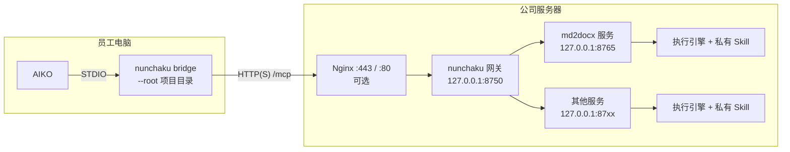

# nunchaku 私有化部署与使用教程

本教程面向两类读者：

- **管理员**：在公司服务器上部署 nunchaku，管理远端 Skill 服务。见第 1～4 章。
- **员工**：在自己电脑的 AIKO 中安装、配置并使用这些服务。见第 5～6 章。

第 7 章是日常运维，第 8 章是常见问题。

---

## 0. 整体结构



| 组件                      | 位置     | 说明                                                                                                         |
| ------------------------- | -------- | ------------------------------------------------------------------------------------------------------------ |
| 服务进程                  | 服务器   | 每个服务一个进程、一个端口，只监听本机。调用时在临时目录里运行执行引擎（Codex、Claude、Hermes、aiko.exe 等） |
| 网关                      | 服务器   | **唯一对外入口**。把每个在线的服务列成一个 MCP 工具，按工具名转发                                      |
| 私有 Skill                | 服务器   | 真正的方法论和脚本，**不会下发给员工**                                                                 |
| nunchaku CLI              | 员工电脑 | 本地桥接器：读取文件 → 调用网关 → 校验冲突 → 写回结果                                                     |
| `nunchaku-remote` Skill | 员工电脑 | 通用连接说明，随 CLI 分发，不含任何服务信息                                                                  |

**关键特性**：服务器新增服务后，员工**只需在 AIKO 里重启一下 MCP 连接**，不需要重新安装任何东西。

---

## 1. 部署前准备

### 1.1 服务器要求

| 项       | 要求                                                                |
| -------- | ------------------------------------------------------------------- |
| 操作系统 | Linux（推荐）或 Windows Server                                      |
| Python   | 3.11 及以上（用 `uv` 管理即可，不必系统安装）                     |
| 工具     | `uv`、`git`（可选）                                             |
| 执行引擎 | 每个服务配置的引擎 CLI 必须在服务器上可用，并已登录或配置好模型凭据 |
| 网络     | 员工电脑能访问网关端口（或 Nginx 端口）                             |

> **执行引擎的凭据只放在服务器上**。员工电脑不需要任何模型账号或 API Key。

### 1.2 规划地址

先确定员工访问网关用的地址，后面所有配置都要用到。下面以 `nunchaku.corp.example.com` 为例：

| 方案                      | 员工使用的地址                            | 适用                 |
| ------------------------- | ----------------------------------------- | -------------------- |
| A. Nginx 反向代理（推荐） | `https://nunchaku.corp.example.com/mcp` | 正式使用             |
| B. 网关直接对内网开放     | `http://10.0.0.20:8750/mcp`             | 快速试用、小范围验证 |

### 1.3 安全须知（请务必阅读）

访问控制分两层：

| 对象                 | 方式           | 说明                                                            |
| -------------------- | -------------- | --------------------------------------------------------------- |
| 管理台               | 管理员账号登录 | 只有管理员能登录；账号在服务器上用命令行创建（第 4 章）         |
| 网关（员工调用服务） | Service Key    | 管理员在管理台为每位使用者生成，并限定可访问的服务（第 4.3 节） |

部署时还须注意：

1. 对外入口一律走 **HTTPS**（Nginx），Service Key 和管理员登录态都不应明文传输。
2. 各服务端口（如 8765）**只监听 `127.0.0.1`**，不要对外开放；它们自身不校验 Key，只应由网关访问。
3. 有条件的话，再用防火墙或 Nginx `allow/deny` 把访问限制在办公网段。
4. 告知员工：提交的文件会传到服务器处理，**不要提交密钥、凭据、无关文件**；Service Key 等同于个人账号密码，不要转借。
5. 私有 Skill 的内容不能仅靠"不要泄露"的提示词做到绝对保密。真正必须保密的规则和数据，应写进服务端脚本或工具，而不是 Skill 文本。

---

## 2. 服务器安装

以下以 Linux、安装目录 `/opt/nunchaku` 为例。Windows 服务器的差异见 2.7。

### 2.1 安装 uv 和代码

```bash
curl -LsSf https://astral.sh/uv/install.sh | sh     # 安装 uv（内网可改用离线包）
sudo mkdir -p /opt/nunchaku && sudo chown $USER /opt/nunchaku
git clone https://github.com/zqllucas123/nunchaku.git /opt/nunchaku
cd /opt/nunchaku
uv sync
uv run nunchaku --help
```

内网有 PyPI 镜像时，在 `uv sync` 前设置：

```bash
export UV_INDEX_URL=https://mirrors.example.com/pypi/simple/
```

### 2.2 放置私有 Skill

每个服务对应一个目录，目录里必须有 `SKILL.md`，可以附带脚本和模板：

```
/srv/private-skills/
└── md-to-docx/
    ├── SKILL.md
    ├── scripts/md_to_docx.py
    └── templates/default.docx
```

建议权限只给运行 nunchaku 的账号：

```bash
sudo chown -R nunchaku:nunchaku /srv/private-skills
sudo chmod -R o-rwx /srv/private-skills
```

### 2.3 编写 `services.json`

在 `/opt/nunchaku/services.json` 中：

```json
{
  "gateway": {"host": "127.0.0.1", "port": 8750},
  "dashboard": {
    "allowed_hosts": ["nunchaku.corp.example.com"],
    "secure_cookies": true,
    "public_gateway_url": "https://nunchaku.corp.example.com/mcp"
  },
  "services": [
    {
      "name": "md2docx",
      "description": "把 Markdown 文档转换为符合公司模板的 Word（.docx）文档。",
      "skill": "/srv/private-skills/md-to-docx",
      "engine": "custom",
      "command": "/usr/local/bin/aiko",
      "args": ["--ci", "--permission-mode", "autoApprove", "--timeout", "170", "-p", "-"],
      "host": "127.0.0.1",
      "port": 8765,
      "timeout_seconds": 180
    }
  ]
}
```

字段说明：

| 字段                             | 说明                                                                                                                                                |
| -------------------------------- | --------------------------------------------------------------------------------------------------------------------------------------------------- |
| `gateway.host`                 | 用 Nginx 时保持 `127.0.0.1`；网关直接对内网开放时改成 `0.0.0.0`                                                                                 |
| `gateway.port`                 | 网关端口，不能和任何服务重复                                                                                                                        |
| `gateway.auth`                 | 是否要求 Service Key，默认 `true`。**只在仅本机访问的开发环境**才设为 `false`                                                             |
| `dashboard.allowed_hosts`      | 经 Nginx 访问管理台时，浏览器地址栏里的主机名（带非标准端口时写 `host:port`）。不在列表里的 Host 会被拒绝                                         |
| `dashboard.secure_cookies`     | 管理台走 HTTPS 时设为 `true`，登录 Cookie 只在 HTTPS 下发送                                                                                       |
| `dashboard.public_gateway_url` | 员工使用的网关地址。管理台会显示它，并写进生成 Key 时给出的配置示例                                                                                 |
| `name`                         | 服务名，也是员工在 AIKO 里看到的**工具名**。小写字母开头，只能含小写字母、数字、`-`、`_`。在管理台改名时，各 Service Key 的授权会自动跟随 |
| `description`                  | **非常重要**。AIKO 靠这段话判断什么时候调用这个服务，请写清楚"做什么、输入什么、产出什么"                                                     |
| `skill`                        | 私有 Skill 目录                                                                                                                                     |
| `engine`                       | `codex`、`claude`、`hermes` 或 `custom`                                                                                                     |
| `command` / `args`           | 自定义引擎的可执行文件和参数。参数里可用 `{prompt}`、`{workspace}`、`{output}`、`{skill}` 占位符；不写 `{prompt}` 时提示词从 stdin 传入   |
| `port`                         | 服务自己的端口，每个服务不同                                                                                                                        |
| `timeout_seconds`              | 单次执行上限。自定义引擎自身的超时（如上面的 `--timeout 170`）应略小于它                                                                          |

管理员账号和 Service Key 不在这个文件里，而是保存在同目录的 `.nunchaku/auth.db`（SQLite，权限 600）。**备份时请一并备份这个文件**；只保存哈希，不含明文 Key 和密码。

校验配置：

```bash
uv run nunchaku --config services.json list
```

### 2.4 用 systemd 常驻运行

创建服务账号：

```bash
sudo useradd --system --home /opt/nunchaku --shell /usr/sbin/nologin nunchaku
sudo chown -R nunchaku:nunchaku /opt/nunchaku
```

`/etc/systemd/system/nunchaku-services.service`（运行所有服务，每个服务一个子进程）：

```ini
[Unit]
Description=nunchaku skill services
After=network-online.target

[Service]
User=nunchaku
WorkingDirectory=/opt/nunchaku
ExecStart=/home/nunchaku/.local/bin/uv run --frozen nunchaku --config services.json serve-all
Restart=on-failure
RestartSec=5
Environment=PYTHONUNBUFFERED=1

[Install]
WantedBy=multi-user.target
```

`/etc/systemd/system/nunchaku-gateway.service`：

```ini
[Unit]
Description=nunchaku gateway
After=nunchaku-services.service
Wants=nunchaku-services.service

[Service]
User=nunchaku
WorkingDirectory=/opt/nunchaku
ExecStart=/home/nunchaku/.local/bin/uv run --frozen nunchaku --config services.json gateway
Restart=on-failure
RestartSec=5
Environment=PYTHONUNBUFFERED=1

[Install]
WantedBy=multi-user.target
```

`/etc/systemd/system/nunchaku-dashboard.service`（管理台，经 Nginx 对外，见 3.1）：

```ini
[Unit]
Description=nunchaku dashboard
After=network-online.target

[Service]
User=nunchaku
# 只给管理台进程读取 systemd journal 的权限，用来在页面上显示 systemd 运行的服务和网关的日志
SupplementaryGroups=systemd-journal
WorkingDirectory=/opt/nunchaku
ExecStart=/home/nunchaku/.local/bin/uv run --frozen nunchaku --config services.json dashboard --port 8789
Restart=on-failure
RestartSec=5
Environment=PYTHONUNBUFFERED=1

[Install]
WantedBy=multi-user.target
```

`SupplementaryGroups=systemd-journal` 只作用于管理台这一个进程，服务进程和网关没有这个权限。不加这一行，管理台仍可使用，只是「运行日志」面板会提示改用 `journalctl` 查看。管理台默认读取 `nunchaku-services`、`nunchaku-gateway` 两个单元的日志；如果你的单元名不同，在 `services.json` 的 `dashboard` 段用 `services_unit`、`gateway_unit` 指定，设为 `""` 表示不读取。

`uv` 的路径以 `which uv` 的结果为准。执行引擎需要的环境变量（如模型 API Key、`PATH`、引擎配置目录）用 `Environment=` 或 `EnvironmentFile=` 加进 `nunchaku-services.service`，**并且同样加进 `nunchaku-dashboard.service`**：在管理台点「启动」的服务是管理台的子进程，继承的是管理台的环境。`nunchaku-services` 只运行它启动时配置里已有的服务，之后在管理台新增的服务都由管理台启动（重启单元时端口已被占用的会被跳过，见 2.5）；管理台缺少这些变量时，引擎会直接退出，员工侧看到 `custom exited 1`。

推荐用 drop-in 文件给管理台补上，内容与 `nunchaku-services.service` 保持一致：

```ini
# /etc/systemd/system/nunchaku-dashboard.service.d/engine.conf
[Service]
EnvironmentFile=/etc/nunchaku/engine.env
Environment=PATH=/opt/nunchaku/skill-venv/bin:/usr/local/bin:/usr/bin:/bin
PrivateTmp=true
```

修改后执行 `sudo systemctl daemon-reload && sudo systemctl restart nunchaku-dashboard`，再在管理台重新启动相关服务。

创建第一个管理员（以服务账号身份执行，确保 `auth.db` 归它所有；密码交互输入，不会进入命令行历史）：

```bash
sudo -u nunchaku /home/nunchaku/.local/bin/uv run --frozen nunchaku --config services.json admin add admin
```

启动：

```bash
sudo systemctl daemon-reload
sudo systemctl enable --now nunchaku-services nunchaku-gateway nunchaku-dashboard
sudo systemctl status nunchaku-services nunchaku-gateway nunchaku-dashboard
journalctl -u nunchaku-gateway -f        # 查看网关日志
```

> 也可以不用 systemd，改用管理台手动启停服务。但管理台退出时会停掉它启动的所有进程，**正式环境请用 systemd**。由 systemd 运行的服务在管理台中显示为「外部运行」。

### 2.5 一个服务只能有一个主管

同一个 `host:port` 只能有一个进程在跑。nunchaku 有两条启动路径，两条都守住这条规则，所以「管理台启动过、随后重启 `nunchaku-services`」这个组合不会互相踩：

- **`nunchaku-services`（`serve-all`）** 只运行它**启动那一刻**配置里已有的服务（见 2.4）。启动时它会先探测每个服务的端口，**已经在监听的会被跳过并打警告**，不会去抢。若硬抢，子进程会因 `[Errno 98] address already in use` 当场退出，而 systemd 单元仍是 active，端口就再也回不到原来的主人手里。
- **管理台**新增或启动服务前会检查端口，已被占用时直接报 `port <n> is already in use`，不会硬起（见 3.2）。

被跳过的服务**不算失败**（进程退出码仍为 0），否则 `Restart=on-failure` 会变成 5 秒一轮的重启循环。重启时的输出形如：

```text
nunchaku: svc is already served on 127.0.0.1:8770; not starting a second copy. ...
nunchaku: serving other on 127.0.0.1:8771
```

要让这个单元重新接管某个服务，先在管理台把它停掉，再重启单元。排查端口到底归谁管：

```bash
systemctl status nunchaku-services      # 列出该单元真正在跑的服务
ss -lptn 'sport = :8770'                # 谁在监听这个端口
```

### 2.6 调整单次运行的产出文件数上限

一个服务单次运行留在工作目录里的文件数，默认上限是 1000。这不是硬顶：改环境变量即可，不必改代码，升级也不会被覆盖。

```ini
# /etc/systemd/system/nunchaku-services.service.d/limits.conf
[Service]
Environment=NUNCHAKU_MAX_OUTPUT_FILES=2000
```

改完执行 `sudo systemctl daemon-reload && sudo systemctl restart nunchaku-services`。

客户端可上传的文件数（50）是另一回事，属于对外契约，**不受这个变量影响**。填了非法值（空、0、负数、非整数）时服务会保留默认值并打一条警告，不会因此起不来。真正的护栏是字节预算（单文件 10 MB、单次合计 20 MB），它不随这个变量放宽。

### 2.7 Windows 服务器的差异

- 路径用 `D:\\nunchaku\\...` 形式，JSON 里反斜杠要写两遍。
- 用 [NSSM](https://nssm.cc/) 把两条命令注册成 Windows 服务：

  ```powershell
  nssm install nunchaku-services "C:\Users\svc\.local\bin\uv.exe" "run --frozen nunchaku --config services.json serve-all"
  nssm set nunchaku-services AppDirectory D:\nunchaku
  nssm install nunchaku-gateway "C:\Users\svc\.local\bin\uv.exe" "run --frozen nunchaku --config services.json gateway"
  nssm set nunchaku-gateway AppDirectory D:\nunchaku
  nssm start nunchaku-services
  nssm start nunchaku-gateway
  ```
- 服务账号需要有执行引擎（如 `aiko.exe`）的运行权限和登录态。
- 在 Windows 防火墙里只放行 Nginx 或网关端口。

---

## 3. 对外开放网关和管理台

### 3.1 方案 A：Nginx 反向代理（推荐）

网关和管理台都保持只监听 `127.0.0.1`，由 Nginx 对外提供 HTTPS。下面把两者放在同一个域名下：`/mcp` 给员工的 AIKO，其余路径给管理员的浏览器。

```nginx
server {
    listen 443 ssl;
    server_name nunchaku.corp.example.com;

    ssl_certificate     /etc/nginx/certs/nunchaku.crt;
    ssl_certificate_key /etc/nginx/certs/nunchaku.key;

    # 网关：员工的 AIKO 访问这里。Service Key 由网关自己校验。
    location = /mcp {
        proxy_pass http://127.0.0.1:8750/mcp;
        proxy_http_version 1.1;

        # 网关只接受 Host 为 127.0.0.1 的请求，不要改成 $host
        proxy_set_header Host 127.0.0.1:8750;
        # 带外部域名的 Origin 会被网关拒绝（403），桥接器本身不发这个头
        proxy_set_header Origin "";
        proxy_set_header X-Forwarded-For $proxy_add_x_forwarded_for;

        # 远端执行最长 180 秒，代理要等得比它久
        proxy_read_timeout 300s;
        proxy_send_timeout 300s;

        # 文件额度为 20 MB，base64 编码后约 27 MB
        client_max_body_size 32m;
        proxy_buffering off;
    }

    # 管理台：管理员用浏览器访问，需要登录。
    location / {
        proxy_pass http://127.0.0.1:8789;
        proxy_http_version 1.1;
        # 原样转发 Host；它必须写在 services.json 的 dashboard.allowed_hosts 里
        proxy_set_header Host $http_host;
        proxy_set_header X-Forwarded-For $proxy_add_x_forwarded_for;
        client_max_body_size 1m;
    }
}
```

几个容易踩的坑：

1. **网关的 `Host` 头必须是 `127.0.0.1:8750`**。网关监听本机时会开启防 DNS 重绑定校验，收到别的 Host 会返回 `421`；带外部域名的 `Origin` 头会返回 `403`，所以一并清掉。
2. **管理台的 `Host` 头反过来要原样转发**，并在 `dashboard.allowed_hosts` 里登记（浏览器地址带非标准端口时写 `host:port`）。否则返回 `400 Invalid host header`。
3. **超时要大于 180 秒**。Nginx 默认 60 秒，会在转换完成前断开。
4. **请求体上限要放大**。Nginx 默认 1 MB，稍大的文档就会返回 `413`。

员工使用的地址：`https://nunchaku.corp.example.com/mcp`；管理员打开 `https://nunchaku.corp.example.com/`。

如果用的是公司内部 CA 签发的证书，员工电脑需要信任这个 CA，见 8.2。

### 3.2 方案 B：网关直接对内网开放

把 `services.json` 中的网关改为：

```json
"gateway": {"host": "0.0.0.0", "port": 8750}
```

然后在防火墙里只对办公网段放行 8750：

```bash
sudo firewall-cmd --permanent --add-rich-rule='rule family=ipv4 source address=10.0.0.0/8 port port=8750 protocol=tcp accept'
sudo firewall-cmd --reload
```

员工使用的地址：`http://<服务器IP>:8750/mcp`

此方案为明文 HTTP，Service Key 会明文传输，且网关不再校验 Host 头，**只建议用于试用**。

### 3.3 验证

在**一台员工电脑**上执行（地址和 Key 换成你的）：

```powershell
curl.exe -s -X POST https://nunchaku.corp.example.com/mcp `
  -H "Authorization: Bearer nk_xxxxxxxx" `
  -H "Content-Type: application/json" -H "Accept: application/json, text/event-stream" `
  -d '{\"jsonrpc\":\"2.0\",\"id\":1,\"method\":\"tools/list\"}'
```

返回内容里应能看到这个 Key 有权访问的服务，如 `"name":"md2docx"`。不带 `Authorization` 头应返回 `401`。工具列表为空时，可能是服务没在运行（网关只列出在线的服务），也可能是这个 Key 没有被授予任何在线服务。

---

## 4. 管理台

### 4.1 管理员账号

管理台只允许管理员登录。账号只能在服务器上用命令行管理（以服务账号身份执行）：

```bash
nunchaku --config services.json admin add <用户名>      # 创建，交互输入密码（至少 8 位）
nunchaku --config services.json admin passwd <用户名>   # 重置密码，并让该账号所有登录失效
nunchaku --config services.json admin list
nunchaku --config services.json admin remove <用户名>
```

登录后可在页面左下角「修改密码」。连续输错 5 次密码，账号锁定 15 分钟；用 `admin passwd` 重置可立即解锁。登录有效期 12 小时。

### 4.2 服务管理

在「服务管理」页可以新增、编辑、删除服务，查看网关地址。由 systemd 运行的服务显示为「外部运行」，不能在页面上启停；修改配置后需在服务器上 `systemctl restart nunchaku-services` 才生效。它们的「运行日志」读取自 systemd journal（需要 2.4 中的 `SupplementaryGroups=systemd-journal`），面板标题旁会注明日志来源。

端口是独占的：新增或启动服务时，若目标端口已被占用，页面会报 `port <n> is already in use` 并拒绝。反过来，如果你在管理台启动过一个服务，之后又重启 `nunchaku-services`，单元会认出该端口已有人服务并跳过它（见 2.5）——这时该服务归管理台管，改配置要在管理台重新启动它。

### 4.3 Service Key

员工访问网关必须携带 Service Key。在「Service Key」页：

1. 点「生成 Service Key」，填写使用者、部门、邮箱、备注。
2. 勾选可访问的服务；或勾选「全部服务（包括以后新增的）」。
3. 可选填写过期时间，到期后自动失效。
4. 生成后**完整 Key 只显示这一次**，同时给出可直接交给员工的 AIKO 配置。服务端只保存哈希，丢失后只能重新生成。

之后可以随时修改授权、停用或删除，**立即生效**，不用重启网关。列表中可以看到每个 Key 的最后使用时间和调用次数；网关日志会记录每次调用的使用者。

- 一个 Key 只能看到、也只能调用被授权的服务；员工在 AIKO 里看不到其他服务。
- 在管理台给服务改名，各 Key 的授权会自动改到新名字；删除服务，各 Key 的授权中也会去掉它。若某个 Key 因此没有任何可访问的服务，它会被自动停用。

---

## 5. 员工电脑：安装与配置

### 5.1 管理员准备安装包

在服务器或任意一台电脑上构建 wheel：

```bash
cd /opt/nunchaku
uv build --wheel
ls dist/          # nunchaku-0.1.0-py3-none-any.whl
```

把 wheel 放到员工能访问的共享位置，例如 `\\fileserver\tools\nunchaku\`。

**内网完全离线时**，还要把依赖的 wheel 一起放进去。在一台能联网的 **Windows** 电脑上执行（员工电脑的 Python 版本按 3.12 准备）：

```powershell
uv venv --python 3.12 .bundle
uv pip install --python .bundle dist\nunchaku-0.1.0-py3-none-any.whl
uv pip freeze --python .bundle | Select-String -NotMatch nunchaku | Out-File -Encoding ascii deps.txt
uv run --no-project --python 3.12 --with pip python -m pip download -r deps.txt -d wheels `
  --only-binary=:all: --platform win_amd64 --python-version 3.12 --implementation cp
Copy-Item dist\nunchaku-0.1.0-py3-none-any.whl wheels\
```

把整个 `wheels` 目录（约 30 个 wheel）复制到共享位置。有内网 PyPI 镜像时，在 `pip download` 后面加 `--index-url <镜像地址>`。员工电脑还需要 Python 3.12，可以由 IT 统一安装，或者把 `uv python install 3.12` 的结果一起分发。

### 5.2 员工安装 CLI

员工电脑需要先装 `uv`（可由 IT 统一分发）。然后：

```powershell
# 能访问 PyPI 或内网镜像时
uv tool install \\fileserver\tools\nunchaku\nunchaku-0.1.0-py3-none-any.whl

# 完全离线时（wheels 目录见 5.1）
uv tool install --offline --no-index --find-links \\fileserver\tools\nunchaku\wheels --python 3.12 nunchaku

nunchaku --help
```

安装后可执行文件在 `C:\Users\<用户名>\.local\bin\nunchaku.exe`，下文称 **nunchaku 路径**。

### 5.3 安装通用连接 Skill

```powershell
nunchaku install-skill --url https://nunchaku.corp.example.com/mcp
```

按提示选 AIKO（通常是 `C:\Users\<用户名>\.sdw\skills`）。也可以直接指定：

```powershell
nunchaku install-skill --path "$HOME\.sdw\skills"
```

这个 Skill 不含任何服务信息，**一台电脑只需装一次**，以后新增服务也不用重装。

### 5.4 在 AIKO 中添加 MCP

1. 打开 AIKO 的 MCP 面板，点「+」。
2. **名称**填 `nunchaku`（连接 Skill 里就是这样称呼它的，请不要改）。
3. **类型**选 **STDIO**。
4. **配置**填写（把用户名、地址、项目目录和 Service Key 换成自己的；Key 向管理员申请）：

```json
{
  "command": "C:\\Users\\zhangsan\\.local\\bin\\nunchaku.exe",
  "args": [
    "bridge",
    "--url",
    "https://nunchaku.corp.example.com/mcp",
    "--root",
    "D:\\work\\docs"
  ],
  "env": {
    "NUNCHAKU_SERVICE_KEY": "nk_xxxxxxxxxxxxxxxx"
  }
}
```

5. 点「测试」，应显示你有权使用的工具（如 `md2docx`）。通过后点「添加」。

注意事项：

- **Service Key 放在 `env` 里**，不要写进 `args`，避免出现在进程列表中。它等同于你的个人账号，不要转借；怀疑泄露时请管理员停用后重新生成。
- **JSON 里的路径要写双反斜杠** `\\`，或者全部改用正斜杠 `/`。
- **`command` 写 `.exe` 的完整路径**，不要只写 `nunchaku`，AIKO 拉起子进程时不一定能找到 PATH 里的命令。
- **`--root` 是读写边界**：桥接器只能读写这个目录下的文件，路径一律相对于它。请填你平时存放待处理文档的目录，**不要填盘符根目录或用户主目录**。
- 想处理多个目录时，可以填它们的公共父目录；或者再加一条 MCP（名称如 `nunchaku-proj2`），这时会话里需要点名使用。

### 5.5 一键安装脚本（可选）

管理员可以把下面的脚本放到共享目录，员工双击或在 PowerShell 中执行：

```powershell
# install-nunchaku.ps1
$Share   = "\\fileserver\tools\nunchaku"
$Gateway = "https://nunchaku.corp.example.com/mcp"

$wheel = Get-ChildItem "$Share\nunchaku-*.whl" | Sort-Object Name | Select-Object -Last 1
uv tool install --force $wheel.FullName
if (-not $?) { Write-Error "安装失败。如果提示拒绝访问，请先退出 AIKO 后重试。"; exit 1 }

& "$HOME\.local\bin\nunchaku.exe" install-skill --path "$HOME\.sdw\skills" --url $Gateway --force

Write-Host ""
Write-Host "安装完成。请在 AIKO 的 MCP 面板中添加名为 nunchaku 的 STDIO 服务器："
Write-Host "  command: $HOME\.local\bin\nunchaku.exe"
Write-Host "  args:    bridge --url $Gateway --root <你的文档目录>"
Write-Host "  env:     NUNCHAKU_SERVICE_KEY = <管理员发给你的 Service Key>"
```

---

## 6. 员工使用

### 6.1 直接用自然语言

在 AIKO 会话里正常描述需求即可，AIKO 会根据服务描述自动选择：

```
把 设计方案.md 转成 docx
```

也可以点名服务：

```
用 nunchaku 的 md2docx 把 docs/周报.md 转成 Word
```

一次调用通常需要几十秒到一两分钟，结果文件会直接写进 `--root` 目录。

### 6.2 路径写法

文件路径必须是**相对于 `--root` 的路径**：

| 写法                              | 结果                        |
| --------------------------------- | --------------------------- |
| `设计方案.md`、`docs/周报.md` | ✅ 正确                     |
| `./设计方案.md`                 | ❌ 不能以 `./` 开头       |
| `D:\work\docs\设计方案.md`      | ❌ 不能是绝对路径           |
| `docs\周报.md`                  | ❌ 要用 `/`，不能用 `\` |
| `../其他目录/a.md`              | ❌ 不能跳出 `--root`      |

### 6.3 先看结果再写入

在需求里加一句"**先不要写入，只给我看结果**"。此时文件不会写到项目中，而是放在 `--root` 下的 `.nunchaku\proposed\` 目录，确认后再自行处理。

### 6.4 文件冲突

如果目标文件已存在（比如之前生成过同名的 docx），或者在转换期间被改动过，桥接器**不会覆盖**，会把它列在冲突里交给 AIKO 处理。想重新生成同名文件，先删除旧文件或换个文件名。

### 6.5 使用限制

| 项         | 限制                                                         |
| ---------- | ------------------------------------------------------------ |
| 单次文件数 | 最多 50 个                                                   |
| 单个文件   | 10 MB                                                        |
| 单次总量   | 20 MB                                                        |
| 单次耗时   | 由服务配置决定，默认 180 秒                                  |
| 上下文     | 每次调用独立，不记得上一次。需要继续时，把必要信息重新说一遍 |

---

## 7. 日常运维

### 7.1 新增服务

1. 把私有 Skill 放到服务器，比如 `/srv/private-skills/translate/`。
2. 在 `services.json` 的 `services` 里加一项，端口用新的（如 8766）。
3. 校验并重启服务进程：

   ```bash
   uv run nunchaku --config services.json list
   sudo systemctl restart nunchaku-services
   ```
4. **网关不需要重启**，它会自动发现配置变化。
5. 在管理台「Service Key」页，给需要的使用者授权这个新服务（授权为「全部服务」的 Key 自动包含它）。
6. 通知员工：**在 AIKO 中重启 `nunchaku` 这条 MCP 连接**，就能看到新工具。

### 7.2 修改或下线服务

- 修改描述、超时等：改 `services.json` 后 `systemctl restart nunchaku-services`。若该服务是**从管理台启动**的，单元不认识它（它不在单元的 cgroup 里），重启单元会跳过它，需在管理台重新启动该服务才生效（见 2.5）。
- 改名、下线**请在管理台操作**：管理台会同步更新各 Service Key 的授权；直接手改 `services.json` 不会。员工下次重连时该工具消失；在此之前调用会得到 `unknown service`。

### 7.3 升级 nunchaku

服务器：

```bash
cd /opt/nunchaku
git pull
uv sync
sudo systemctl restart nunchaku-services nunchaku-gateway nunchaku-dashboard
```

`git pull` 只动 `/opt/nunchaku` 下的代码，不碰 `/etc/systemd/system/*.service.d/` 里的 drop-in，所以你在那里设的 `NUNCHAKU_MAX_OUTPUT_FILES` 等会照常生效，不会被升级覆盖（见 2.6）。

员工电脑：重新构建并分发 wheel，员工执行 `uv tool install --force <新 wheel>`。**升级前必须先退出 AIKO**，否则会报"拒绝访问"（见 8.1）。

### 7.4 日志

| 进程         | 查看方式                                                                                                                      |
| ------------ | ----------------------------------------------------------------------------------------------------------------------------- |
| 服务进程     | 管理台中选中该服务看「运行日志」；或 `journalctl -u nunchaku-services -f`；用管理台启动时在 `.nunchaku/logs/<服务名>.log` |
| 网关         | 管理台网关卡片的「查看日志」；或 `journalctl -u nunchaku-gateway -f`；用管理台启动时在 `.nunchaku/logs/_gateway.log`      |
| 员工端桥接器 | 写到 stderr，在 AIKO 的 MCP 日志中查看                                                                                        |

一次正常调用在服务端的日志大致如下：

```
10:20:06 INFO    [md2docx] call started by 张三 (nk_82c2af…): 1 file(s), task='把 设计方案.md 转成 docx'
10:20:06 INFO    [md2docx] run started: 1 input file(s), 11292 bytes, task='把 设计方案.md 转成 docx'
10:20:06 INFO    [md2docx] engine started: /usr/local/bin/aiko (timeout 180s)
10:20:54 INFO    [md2docx] engine finished in 48.2s with code 0
10:20:54 INFO    [md2docx] run finished in 48.3s: 2 changed, 0 deleted, answer 544 chars
10:20:54 INFO    [md2docx] call finished in 48.4s: 2 changed, 0 deleted
```

网关日志会注明每次调用的使用者和 Key 前缀；被拒绝的请求（缺少或无效的 Key、访问未授权的服务）记为 `WARNING`。

需要更多细节时，在启动命令里加 `--log-level DEBUG`（如 `nunchaku --log-level DEBUG --config services.json gateway`），会逐个列出改动的文件。

日志中会记录任务描述的前 60 个字符。如果任务内容敏感，可用 `--log-level WARNING` 只保留告警和错误。

---

## 8. 常见问题

### 8.1 员工端

**升级时报 `failed to remove directory ...\uv\tools\nunchaku\Scripts: 拒绝访问`**
AIKO 正在运行桥接器，占用了这个目录。完全退出 AIKO（包括托盘图标）后重试。如果之后运行 `nunchaku` 报 `No module named 'nunchaku'`，说明上次安装中途失败，退出 AIKO 后重新执行 `uv tool install --force <wheel>` 即可。

**AIKO 测试连接失败，stderr 里有 `cannot reach gateway`**
连不上网关。先用 3.3 的 `curl` 在本机测试；检查地址、端口、防火墙、代理。如果公司有 HTTP 代理，把网关域名加入 `NO_PROXY`，例如在 MCP 配置的 `env` 里写 `{"NO_PROXY": "nunchaku.corp.example.com"}`。

**`cannot reach gateway ...: 401 Unauthorized: check NUNCHAKU_TOKEN`**
Service Key 缺失、写错、已停用或已过期。检查 MCP 配置 `env` 里的 `NUNCHAKU_SERVICE_KEY`；仍不行请管理员在管理台确认该 Key 的状态。

**`this service key may not use xxx`**
你的 Key 没有被授权使用这个服务，请向管理员申请。

**`project root is not a directory`**
`--root` 填的目录不存在，常见原因是把示例路径原样留在了配置里。

**`not a regular file: xxx.md`**
文件不在 `--root` 目录下，或者相对路径写错。

**`file path must be a non-empty POSIX relative path`**
路径以 `./` 开头、用了反斜杠或盘符。见 6.2。

**工具列表里看不到新服务**
在 AIKO 里重启 `nunchaku` 这条 MCP 连接。仍然没有的话，请管理员确认该服务已启动。

**调用超时**
服务端单次最长约 180 秒。如果 AIKO 支持设置 MCP 工具超时，请设为 210 秒以上。

**报错里的中文显示为乱码**
是 stderr 编码不一致，不影响功能。

### 8.2 HTTPS 证书

**`certificate verify failed`**
网关用的是公司内部 CA 签发的证书，员工电脑的 Python 不认识。在 AIKO 的 MCP 配置里指定 CA 文件：

```json
"env": {"SSL_CERT_FILE": "C:\\certs\\corp-root-ca.pem"}
```

### 8.3 服务器端

**Nginx 返回 `421 Misdirected Request`**
没有按 3.1 设置 `proxy_set_header Host 127.0.0.1:8750;`。

**管理台返回 `400 Invalid host header`**
浏览器地址里的主机名（含非标准端口）不在 `dashboard.allowed_hosts` 里，或 Nginx 没有原样转发 `Host`。

**管理台登录后立刻又跳回登录页**
`dashboard.secure_cookies` 为 `true`，但用 `http://` 访问，浏览器不会发送 Cookie。改用 HTTPS，或在纯本机调试时设为 `false`。

**管理员忘记密码或账号被锁定**
在服务器上执行 `nunchaku --config services.json admin passwd <用户名>`。

**Nginx 返回 `403`，网关日志里有 `Invalid Origin header`**
没有按 3.1 设置 `proxy_set_header Origin "";`。

**Nginx 返回 `413 Request Entity Too Large`**
没有调大 `client_max_body_size`。

**大约 60 秒后返回 `504`**
没有调大 `proxy_read_timeout`。

**调用报 `remote skill failed: ... engine timed out after 180s`**
执行引擎没在时限内完成。可以调大该服务的 `timeout_seconds`（同时调大引擎自身的超时、Nginx 的 `proxy_read_timeout`、员工端 AIKO 的工具超时），或优化 Skill。

**调用报 `remote skill failed: ... exited 1`**
执行引擎运行失败。查看服务日志里 `engine exited` 那一行附带的错误输出。常见原因是服务账号下引擎未登录、模型凭据缺失或无权限。

**`engine executable unavailable`**
`command` 填的路径在服务器上不存在，或服务账号没有执行权限。

**`gateway port ... is already used by a service`**
网关端口和某个服务的端口重复了。

---

## 附录：员工快速上手卡

> 可以直接转发给员工。

1. 向管理员申请 **Service Key**（形如 `nk_…`），它等同于你的个人账号，不要转借。
2. 安装：`uv tool install \\fileserver\tools\nunchaku\nunchaku-0.1.0-py3-none-any.whl`
3. 装 Skill：`nunchaku install-skill --path "$HOME\.sdw\skills"`
4. AIKO → MCP → 「+」→ 名称 `nunchaku`，类型 STDIO，配置：

   ```json
   {
     "command": "C:\\Users\\<你的用户名>\\.local\\bin\\nunchaku.exe",
     "args": ["bridge", "--url", "https://nunchaku.corp.example.com/mcp", "--root", "D:\\<你的文档目录>"],
     "env": {"NUNCHAKU_SERVICE_KEY": "<你的 Service Key>"}
   }
   ```
5. 测试 → 添加。
6. 会话中直接说：「把 xxx.md 转成 docx」。文件名写相对路径，不要加 `./`。
7. 管理员通知有新服务时：在 AIKO 中重启 `nunchaku` 连接。
8. 升级前先退出 AIKO。
